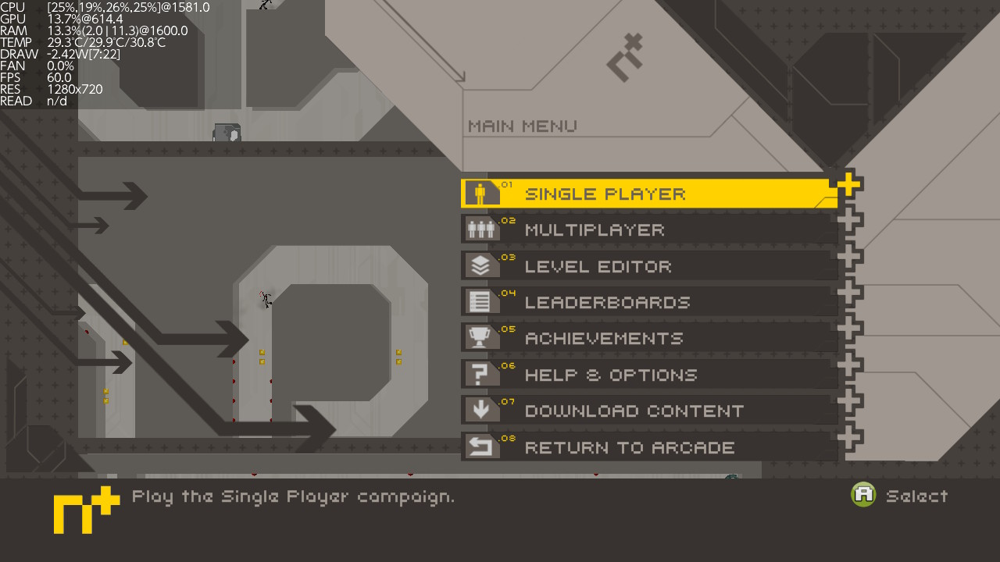
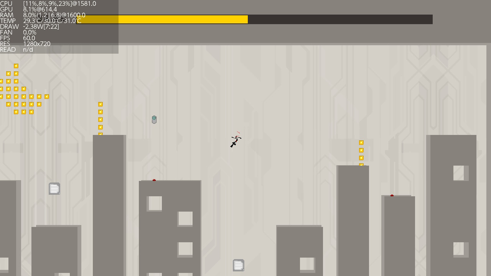

<h1 align=center>nplus-nx</h1>

<p align=center>A Nintendo Switch port of the Xbox 360 Arcade game N+</p>

<p align="center"> 
  
  
</p>

This is a full switch port of a game I knew as a kid and only had the demo of. It comes with all 3 DLCs having full support, all shaders/levels work, and full 60fps. NO GAME FILES ARE INCLUDED! The PC port including all game files can be obtained by yourself at [TheIncredibleHolc/N_Plus](https://github.com/TheIncredibleHolc/N_Plus) on GitHub, that is what this port was built off of.

## What works

- The menus, the tutorials, all of the N+ episodes and the 3 level packs (the DLC)
- 60fps with sound, on the PC build and on Switch
- Everything renders right, all 17 of the game's shaders are translated for the Switch
- The full game is unlocked, not the trial

I've tested it on the PC build (on my Mac) and on Switch through Ryujinx. Stock Ryujinx can't run it, so there's a
patch for that further down.

## What you need

- A Mac with Apple Silicon. That's what I built it on. Linux should be close since the base came from Linux ports, but
  I haven't tried it. (I built this on a M3 MacBook Air, 16G ram running macOS 27.2)
- [Homebrew](https://brew.sh)
- [devkitPro](https://devkitpro.org) for the Switch toolchain
- The N+ PC port download (`N_Plus.zip`). That's where the game files come from.

P.S. You have to build the PC version first, and then the switch version.

## Getting the game files

Everything comes out of the `data` folder in `N_Plus.zip`:

- `data/Original/default.xex` is only the header, and `data/Original/NPlus.exe` is the actual game code. A script puts
  them back together into a `default.xex` that works.
- `data/Extracted/Data0.zip` and `Data1.zip` are the game's levels, menus and effects. Leave them zipped, the game reads
  them like that.
- `data/DLC` has the 3 level packs.

Make a folder for the game (I used `~/nplus/game`) and set it up:

```bash
python3 tools/nplus_make_xex.py data/Original/default.xex data/Original/NPlus.exe ~/nplus/game/default.xex
cp data/Extracted/Data0.zip data/Extracted/Data1.zip ~/nplus/game/
ln -s ~/nplus/game app/assets
```

## Setting up the tools

From Homebrew:

```bash
brew install cmake ninja python spirv-cross zstd
```

Then make a Python venv for the build scripts:

```bash
python3 -m venv ~/nplus/.venv
~/nplus/.venv/bin/pip install xxhash pillow
```

For devkitPro, install the macOS package from [devkitPro/pacman](https://github.com/devkitPro/pacman/releases/latest).
Running `dkp-pacman` with plain `sudo` breaks on the signature check ("Invalid crypto engine") because sudo can't find
devkitPro's gpg, so give it its own PATH:

```bash
sudo env PATH="/opt/devkitpro/pacman/bin:/usr/bin:/bin:/usr/sbin:/sbin" /opt/devkitpro/pacman/bin/pacman -Syu switch-dev switch-portlibs deko3d uam
export DEVKITPRO=/opt/devkitpro
export DEVKITA64=$DEVKITPRO/devkitA64
```

The shader translator needs DXC, and only its headers are in this repo. Clone
[renderbag/dxc-bin](https://github.com/renderbag/dxc-bin) somewhere and copy the Mac files in. The `bin/lib` link is
there so `dxc-macos` can find its library:

```bash
D=app/thirdparty/reblue-XenosRecomp/thirdparty/dxc-bin
mkdir -p $D/lib/arm64 $D/bin/arm64
cp <dxc-bin clone>/lib/arm64/libdxcompiler.dylib $D/lib/arm64/
cp <dxc-bin clone>/bin/arm64/dxc-macos $D/bin/arm64/
ln -sfn ../lib/arm64 $D/bin/lib
```

Last, build glslangValidator and uam from the copies in the repo, and link spirv-cross where the shader tools look for
it:

```bash
cmake -S sdk/thirdparty/glslang -B out/glslang -G Ninja -DCMAKE_BUILD_TYPE=Release -DENABLE_OPT=OFF \
  -DGLSLANG_TESTS=OFF -DENABLE_GLSLANG_BINARIES=ON -DENABLE_HLSL=OFF -DGLSLANG_ENABLE_INSTALL=OFF \
  -DCMAKE_POLICY_VERSION_MINIMUM=3.5
cmake --build out/glslang --target glslangValidator
cmake -S app/thirdparty/uam -B out/deko3d_tools/uam-build -G Ninja -DCMAKE_BUILD_TYPE=Release
ninja -C out/deko3d_tools/uam-build uam_tool
ln -sf "$PWD/out/deko3d_tools/uam-build/uam" out/deko3d_tools/uam-build/uam.exe
mkdir -p out/deko3d_tools/spirv-cross-build
ln -sf /opt/homebrew/bin/spirv-cross out/deko3d_tools/spirv-cross-build/spirv-cross.exe
```

## Building

**1. The code generator**

```bash
cd sdk
cmake -B build-host -G Ninja -DCMAKE_BUILD_TYPE=Release
cmake --build build-host --target rexglue
cd ..
```

**2. Generate the code from the game**

```bash
bash tools/codegen.sh "$PWD/sdk/out/mac-arm64/rexglue"
~/nplus/.venv/bin/python tools/post_codegen.py
```

This writes about 107 MB of C++ into `app/generated`. Never commit it, it's made from the game.

**3. The PC build**

You need the PC build even if you only want the Switch one. N+ compiles its shaders while it runs, and the PC build is
what catches them. Make the empty shader folder first, then build:

```bash
~/nplus/.venv/bin/python tools/renut_shader_dump.py --image out/renut_image.bin --out out/renut_shader_dump
cmake -S app -B app/out/pc_host -G Ninja -DCMAKE_BUILD_TYPE=Release -DREXSDK_DIR="$PWD/sdk" \
  -DREXGLUE_USE_VULKAN=ON -DREXGLUE_USE_D3D12=OFF \
  -DPython3_EXECUTABLE="$HOME/nplus/.venv/bin/python" \
  -DBANJO_GLSLANG_VALIDATOR="$PWD/out/glslang/StandAlone/glslangValidator" \
  -DRENUT_SHADER_DUMP_DIR="$PWD/out/renut_shader_dump"
cmake --build app/out/pc_host -j5
```

`-j5` is for 16 GB of RAM. The generated files are big, so go lower if the build runs out of memory.

**4. Catch the shaders**

Run it and play a bit. Getting into a level is enough, there are only 17 shaders.

```bash
tools/nplus/run_pc.sh 90 first
```

Every shader it hasn't seen before gets saved to `app/out/pc_host/shader_capture`. Build the PC version again and they
get added in:

```bash
cmake --build app/out/pc_host -j5
```

**5. The Switch shaders**

```bash
tools/nplus/switch_shaders.sh
```

This translates them for deko3d and puts them in `app/out/renut_switch`. It should say `17 shaders: 17 compiled, 0 failed`.

**6. The Switch build**

```bash
cmake -S app -B app/out/switch -G Ninja -DCMAKE_BUILD_TYPE=Release \
  -DCMAKE_TOOLCHAIN_FILE="$PWD/tools/switch/cmake/switch-devkitA64.cmake" -DREXSDK_DIR="$PWD/sdk" \
  -DPython3_EXECUTABLE="$HOME/nplus/.venv/bin/python" \
  -DBANJO_GLSLANG_VALIDATOR="$PWD/out/glslang/StandAlone/glslangValidator"
cmake --build app/out/switch -j4
```

You end up with `app/out/switch/renut.nro`, around 47 MB. It took me about 7 minutes. (This entirely depends on the system you are building it on. 7 minutes is what it took for my M3 MacBook Air, so expect longer if you have a slower system.)

## Putting it on your Switch

You need custom firmware (Atmosphère) and hbmenu. Set up the SD card like this:

```text
sdmc:/switch/nplus-nx/
├── nplus-nx.nro        (app/out/switch/renut.nro, renamed)
└── game_root/
    ├── default.xex     (the one you made)
    ├── Data0.zip
    └── Data1.zip
```

For the DLC, run the install script with the SD card mounted. It sets up the folders the game looks in:

```bash
tools/nplus/install_dlc.sh data/DLC /Volumes/<your SD card>/switch/nplus-nx/renut
```

Open it from hbmenu. Hold R while opening an installed game so it gets full RAM, applet mode doesn't give it enough.
The first time it runs it makes `nplus.toml` next to the NRO, that's where your settings go.

## Testing in Ryujinx

Stock Ryujinx can't run this. It crashes right at the start with `MapProcessCodeMemory() = InvalidHandle` in its log,
and even when it gets further, red and blue get swapped on anything with vertex colors (the timer bar turns cyan). Real
hardware doesn't do either of those things, so I patched Ryujinx to match it. The patch is
`tools/nplus/ryujinx-1.3.3-nplus.patch`, for Ryubing 1.3.3:

```bash
git clone --depth 1 --branch 1.3.3 https://git.ryujinx.app/ryubing/ryujinx.git
cd ryujinx
git apply <path to nplus-nx>/tools/nplus/ryujinx-1.3.3-nplus.patch
brew install dotnet@9
export DOTNET_ROOT="$(brew --prefix dotnet@9)/libexec"
"$(brew --prefix dotnet@9)/bin/dotnet" build src/Ryujinx -c Release -r osx-arm64
```

If the build can't download its packages, the feeds in its `nuget.config` moved after 1.3.3. Point `LibHacAlpha` at
`https://git.ryujinx.app/api/packages/projects/nuget/index.json` and delete the `Ryujinx.UpdateClient` source and its
mapping, nuget.org has those packages now.

I keep a separate Ryujinx data folder for this so it doesn't mess with my normal setup. Copy your `system` folder,
`bis/system` and `Config.json` into `~/nplus/ryu-data/nplus`, and set the game up in
`~/nplus/ryu-data/nplus/sdcard/switch/nplus-nx` like the SD card above. Turn on the hypervisor (`"use_hypervisor": true`
in that Config.json). Ryujinx's JIT gets some of the vector instructions wrong and the startup self-check catches it.
Then:

```bash
RYUJINX=<ryujinx clone>/src/Ryujinx/bin/Release/net9.0/osx-arm64/Ryujinx tools/nplus/run_ryujinx.sh 120 test
```

Logs and screenshots end up in `out/emu_runs/test`.

## Settings

Your settings go in `nplus.toml` next to the NRO. The defaults are mostly fine. The ones that matter for N+:

- `frame_cap = "60"`. N+'s physics run once per frame, so if this is off the game speeds up whenever the frame rate
  goes over 60.
- `license_mask` is 1 by default, that's what makes it the full game. Set it to 0 if you want to see the trial.
- `input_xbox_layout = false` is the default, so the buttons go by the letters on the Switch (A is A). Set it to `true`
  if you want them by position like an Xbox pad, where the bottom button (B) acts as A.

## Folders

| Folder | What's in it |
| --- | --- |
| `app/` | The game side and Renut, the Direct3D renderer (`app/src/renut_engine/gpu`), plus the shader translator |
| `sdk/` | The ReXGlue SDK with the Switch layer |
| `tools/` | The code generation steps, shader tools and build scripts |
| `tools/nplus/` | The N+ scripts: running, shaders, DLC, the hook map tools and the Ryujinx patch |
| `docs/nplus-notes.md` | My notes on everything N+ needed: the device layout, the hooks, the addresses and the test runs |

## How it was made

This is built on [renut_nx_ultimate_base](https://github.com/ChanseyIsTheBest/renut_nx_ultimate_base), the Beautiful Katamari port that has every other renut port's fixes in it. N+ was made with nearly the same version of Microsoft's Xbox 360 dev kit as Katamari, so it was a better starting point than my Angry Birds port ([rehatched-nx](https://github.com/slicey64/rehatched-nx)).

To get N+ running on it I had to:

- move the renderer's Direct3D hooks over to N+'s own functions (`app/config/nplus_hook_map.tsv` has every one and why)
- adjust the Direct3D device offsets, since N+'s device is Katamari's with 16 more bytes in it
- find the game addresses the renderer reads, and N+'s own setjmp/longjmp
- add the 349 functions the code generator missed, found in the game's own code
- make it build on macOS

The details are all in [docs/nplus-notes.md](docs/nplus-notes.md).

## Credits

- **[TheIncredibleHolc](https://github.com/TheIncredibleHolc/N_Plus)**: the N+ PC port, which is where the game files
  come from.
- **ChanseyIsTheBest**: the renut ports and the ultimate base this is built on.
- **[Tom Clay](https://github.com/rexglue/rexglue-sdk)**: the ReXGlue SDK, built on the work of the
  **[Xenia](https://xenia.jp)** team.
- **[masterspike52](https://github.com/masterspike52/reNut)**: reNut and its Direct3D-level renderer.
- **[StevensND](https://github.com/StevensND/nfsmw-nx)**: the SDK's Switch layer from nfsmw-nx.
- **[nebadasSwifty](https://github.com/nebadasSwifty/masseffect-nx)**: masseffect-nx.
- **[hedge-dev](https://github.com/hedge-dev/XenosRecomp)**: XenosRecomp, the shader translator.
- **[plume](https://github.com/renderbag/plume)**, **[deko3d](https://github.com/devkitPro/deko3d)** and
  **[uam](https://github.com/devkitPro/uam)** by fincs, plus **[devkitPro](https://devkitpro.org)** and
  **[switchbrew](https://github.com/switchbrew/libnx)**.
- **[KhronosGroup](https://github.com/KhronosGroup/SPIRV-Cross)**: SPIRV-Cross.
- **[Ryubing](https://git.ryujinx.app/ryubing/ryujinx)**: the Ryujinx I tested it on.
- Every port whose fixes are in the base. They're listed in [docs/ultimate-fixes.md](docs/ultimate-fixes.md), and the
  other libraries are in [THIRD_PARTY_NOTICES.md](THIRD_PARTY_NOTICES.md).
- N+ itself was made by [Metanet Software](https://www.metanetsoftware.com). If you like it, go buy
  [N++](https://store.steampowered.com/app/230270/N_NPLUSPLUS/).

## Legal

I'm not affiliated with Metanet, Microsoft or Nintendo. This repo has no game files and no code generated from the
game. You have to supply your own, and everything made from it (`app/generated`, the shaders) is made on your own
computer. Running homebrew needs custom firmware, which is against Nintendo's terms and can get your console banned.
That's up to you.
Remember, always use EMUMMC

The code is GPL-3.0 (see [LICENSE](LICENSE)), same as the ports it's built on. The SDK keeps its BSD-3-Clause license
(see [THIRD_PARTY_NOTICES.md](THIRD_PARTY_NOTICES.md)).

### AI notice

I definitely had Claude help me with this. If you care enough to not use a Switch port because of AI assistance, that's entirely your decision. Almost none of these ports would be possible without AI, but they also wouldn't be possible without the countless hours of work poured in by real people to get the ReXglue sdk and the existing Switch ports working. Hats off to everyone who has paved the path for us to be able to port stuff like this so easily, you guys are more than legends.
